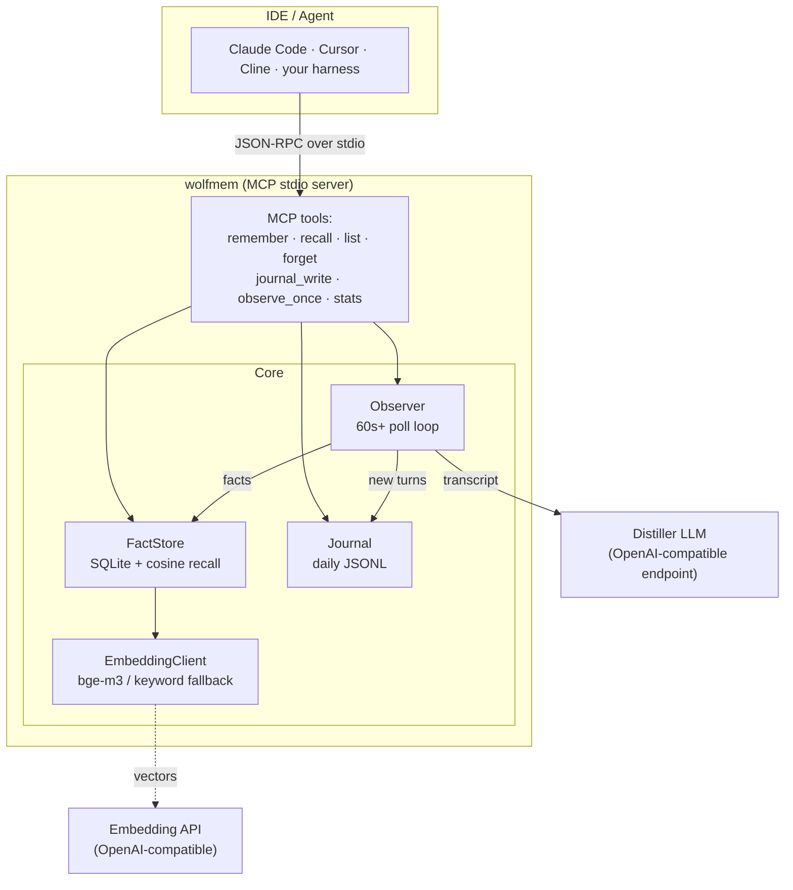
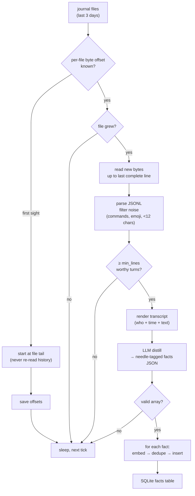
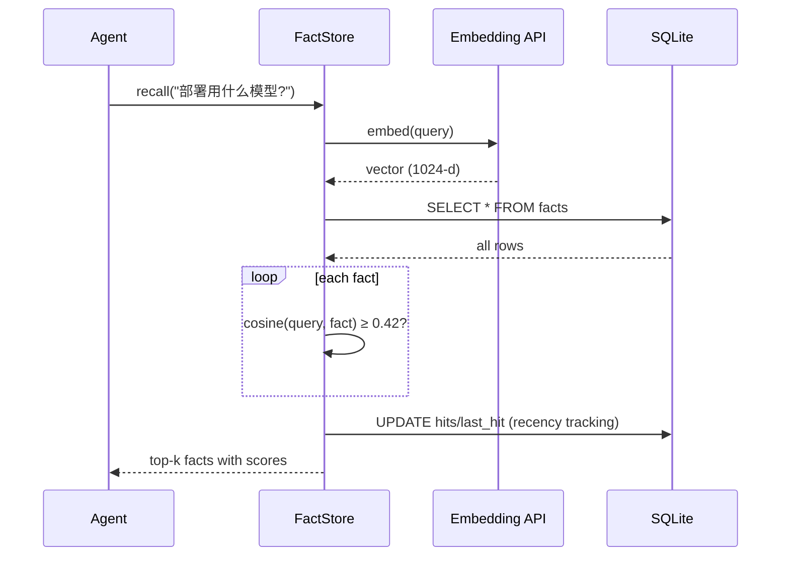

# wolfmem 🐺

**Persistent memory for AI agents and IDEs.** A daily journal holds the raw
conversation ledger, a background observer distills it into durable facts with
an LLM, and a vector-backed SQLite store recalls them — exposed over MCP so
Claude Code, Cursor, Cline, Zed or your own agent can plug in with one line.

English | [简体中文](README.zh-CN.md)

```text
pip install wolfmem        # then:
wolfmem serve              # MCP server on stdio — that's it
```

---

## Why

LLM sessions forget everything the moment the context window closes. Context
files rot. RAG over raw chat dumps noise.

wolfmem splits the problem into three small pieces:

| Layer | Job | Storage |
|---|---|---|
| **Journal** | append-only ledger of every conversation turn | `~/.wolfmem/journal/YYYY-MM-DD.jsonl` |
| **Observer** | polls the journal, distills *durable* facts via LLM | background loop |
| **FactStore** | embeds + stores facts, recalls by similarity | SQLite, one row per fact |

Facts are needle-tagged so both humans and machines can filter them later:

```
[决定] 观察者改用 httpx 直连 LLM 端点并带真超时
[坑]   C2C 内联键盘硬限制 5 行，按钮超行发送必失败
[隐私] 私聊底账禁止发往境外模型，数据不出境
[安全] 令牌只进配置文件，不进日志
[偏好] 深夜回复喜欢短句
[事实] 项目仓库在 github.com/xiaoxiaoyinlang999/wolfmem
```

---

## Architecture



Everything lives in one data directory (`WOLFMEM_HOME`, default `~/.wolfmem`).
No daemon, no server process, no cloud — the MCP server is the process.

## The observer loop

The observer is what makes the memory *automatic*. You don't call `remember`
for every good idea; you just talk, and the ledger gets distilled:



Design choices that survived production:

- **Byte offsets, not timestamps.** Restarts never re-read or skip a turn.
- **First sight starts at the tail.** Bootstrapping a new journal must not
  retroactively burn LLM tokens on weeks of history.
- **Complete lines only.** A half-flushed JSON line waits for the next tick
  instead of crashing the parser.
- **Hard HTTP timeout, one tick.** A hung LLM endpoint costs one poll cycle,
  never the loop (learned the hard way: some provider SDKs swallow
  `CancelledError` — plain HTTP with a real timeout cannot hang forever).

## Recall



No embedding key configured? The store silently switches to a CJK-aware
keyword-overlap scorer — zero-network mode for offline use and CI tests.

---

## Quick start

### 1. Install

```bash
pip install wolfmem
```

Or from source:

```bash
git clone https://github.com/xiaoxiaoyinlang999/wolfmem
cd wolfmem && pip install .
```

### 2. Configure (optional)

wolfmem works offline out of the box (keyword recall, no distiller). For the
full experience, point it at OpenAI-compatible endpoints:

```bash
export WOLFMEM_EMB_KEY="sk-..."            # embeddings (e.g. siliconflow bge-m3)
export WOLFMEM_LLM_API_BASE="https://your-llm.example/v1"   # no /chat/completions suffix
export WOLFMEM_LLM_KEY="sk-..."
export WOLFMEM_LLM_MODEL="glm-5.3-flash"   # any OpenAI-compatible model
```

See `.env.example` for the complete list.

> **Privacy note:** the observer sends raw journal text to `WOLFMEM_LLM_API_BASE`.
> Point it at a provider you trust — if your journal holds private
> conversations, prefer a domestic/on-prem endpoint over third-party clouds.

### 3. Wire it into your IDE

**Claude Code:**

```bash
claude mcp add wolfmem -- wolfmem serve
```

**Claude Desktop** (`claude_desktop_config.json`):

```json
{
  "mcpServers": {
    "wolfmem": {
      "command": "wolfmem",
      "args": ["serve"],
      "env": { "WOLFMEM_EMB_KEY": "sk-..." }
    }
  }
}
```

**Cursor / Cline / Zed:** any MCP client with a stdio transport — command
`wolfmem`, args `["serve"]`.

**Programmatic (Python):**

```python
from wolfmem import WolfmemConfig, Journal, FactStore, EmbeddingClient, Observer

config = WolfmemConfig()
journal = Journal(config.journal_dir)
store = FactStore(config, EmbeddingClient(config))

await store.remember("[决定] persistence is SQLite", importance=3)
hits = await store.recall("what database do we use?")

observer = Observer(config, journal, store)
result = await observer.observe_once()   # one distill pass
```

### 4. CLI

```bash
wolfmem journal user "我们决定用 SQLite 存事实"   # write a ledger turn
wolfmem observe --once                          # distill now
wolfmem list                                    # what do I remember
wolfmem recall "存储方案"                        # semantic search
wolfmem stats                                   # counts by needle tag
wolfmem forget "[坑]"                            # forget by tag/keyword/id
```

---

## MCP tools

| Tool | Input | Effect |
|---|---|---|
| `remember` | `text`, `importance` | store one fact (dedupes by embedding) |
| `recall` | `query`, `top` | semantic search, returns scored facts |
| `list_memories` | `limit` | newest facts first |
| `forget` | `target` | delete by id / tag / keyword |
| `journal_write` | `who`, `text`, `session` | append a turn to the ledger |
| `observe_once` | — | run one observer scan immediately |
| `stats` | — | counts by needle tag, embedding availability |

## Design decisions

- **SQLite over a vector DB.** At ≤ a few thousand facts, brute-force cosine
  in Python is instant, and the operational cost of a real vector DB is not
  worth it. The schema keeps one JSON column of floats per fact.
- **Dedupe by embedding (0.93) before insert.** The observer will re-derive
  the same fact from repeated conversations; near-identical entries update
  instead of piling up.
- **Capacity with eviction.** Past `WOLFMEM_MAX_FACTS` (default 800), the
  least important / least recalled slice gets evicted — memory should forget
  like memory, not grow like a log.
- **Needle tags are part of the text**, not a column: they survive any export,
  grepping and LLM reading, and they make `forget "[坑]"` a one-liner.
- **Stdin/stdout is the protocol channel.** The server logs to stderr only,
  so piping debug output never corrupts the MCP stream.

## Origin

wolfmem is the distilled, framework-free core of the memory system running
inside an AstrBot QQ assistant ("Silver Wolf"): the daily chat ledger
(`wolfmem`), the LLM fact observer (`selfmem`), and the memory-file layer —
rebuilt as one small library with an MCP front door. The Chinese needle tags
are kept on purpose; they are load-bearing.

## License

MIT
