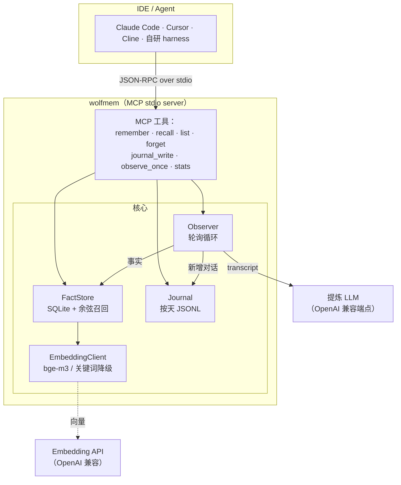
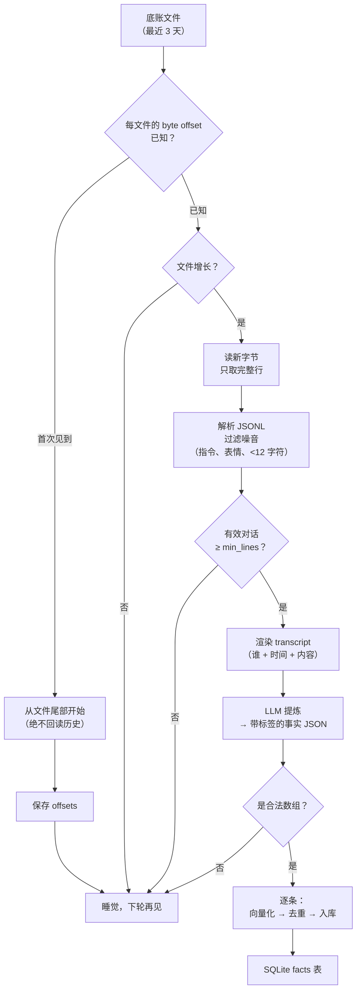
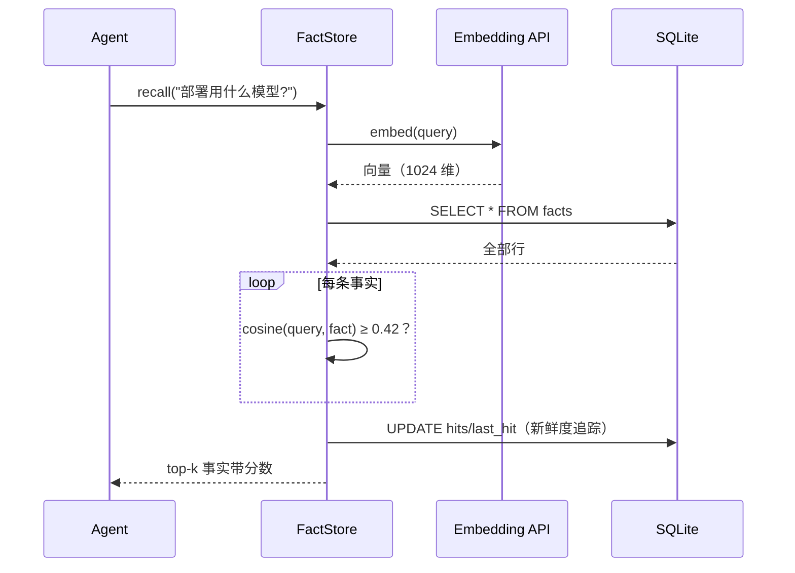

# wolfmem 🐺

**给 AI Agent 和 IDE 用的持久记忆。** 按天落盘的对话底账、后台观察者自动提炼事实、向量检索的 SQLite 事实库——通过 MCP 暴露出去，Claude Code、Cursor、Cline、Zed 或者你自己的 Agent，一行命令就能接入。

[English](README.md) | 简体中文

```text
pip install wolfmem        # 然后一条命令：
wolfmem serve              # MCP server（stdio）——就这样
```

---

## 为什么

LLM 会话一关上下文就全忘了。context 文件越写越乱。对原始聊天记录做 RAG，噪音比信号多。

wolfmem 把问题拆成三个小块：

| 层 | 职责 | 存储 |
|---|---|---|
| **Journal** | 每轮对话的追加式底账（ground truth） | `~/.wolfmem/journal/YYYY-MM-DD.jsonl` |
| **Observer** | 轮询底账，用 LLM 提炼*值得长期记住*的事实 | 后台循环 |
| **FactStore** | 向量化 + 存储 + 相似度召回 | SQLite，一行一条事实 |

事实带「needle 标签」，人和机器都能按标签过滤：

```
[决定] 观察者改用 httpx 直连 LLM 端点并带真超时
[坑]   C2C 内联键盘硬限制 5 行，按钮超行发送必失败
[隐私] 私聊底账禁止发往境外模型，数据不出境
[安全] 令牌只进配置文件，不进日志
[偏好] 深夜回复喜欢短句
[事实] 项目仓库在 github.com/xiaoxiaoyinlang999/wolfmem
```

---

## 架构



所有数据都在一个目录里（`WOLFMEM_HOME`，默认 `~/.wolfmem`）。没有守护进程、没有服务端、没有云——MCP server 本身就是唯一的进程。

## 观察者循环

观察者是让记忆*自动化*的关键：你不用每句话都调 `remember`，正常聊天就行，底账会被自动提炼：



在生产环境里活下来的几个设计决定：

- **byte offset，不是时间戳。** 重启不重读、不漏读。
- **首次见到从尾部开始。** 新底账接入时不会把几周的历史拿去烧 token。
- **只消费完整行。** 写了一半的 JSON 行等下一轮，解析器不会炸。
- **硬 HTTP 超时，最多废一轮。** LLM 端点挂死只损失一次轮询，循环本身永不阻塞（血的教训：某些 provider SDK 会吞 `CancelledError`——裸 HTTP 加真超时不可能永远挂着）。

## 召回



没配 embedding key？store 静默切换成 CJK 感知的关键词重合度打分——零网络模式，离线可用，CI 测试也能跑。

---

## 快速开始

### 1. 安装

```bash
pip install wolfmem
```

或从源码：

```bash
git clone https://github.com/xiaoxiaoyinlang999/wolfmem
cd wolfmem && pip install .
```

### 2. 配置（可选）

wolfmem 开箱即用（关键词召回、无提炼器）。要完整体验，接上 OpenAI 兼容端点：

```bash
export WOLFMEM_EMB_KEY="sk-..."            # embedding（如 siliconflow bge-m3）
export WOLFMEM_LLM_API_BASE="https://your-llm.example/v1"   # 不带 /chat/completions 后缀
export WOLFMEM_LLM_KEY="sk-..."
export WOLFMEM_LLM_MODEL="glm-5.3-flash"   # 任何 OpenAI 兼容模型
```

完整变量列表见 `.env.example`。

> **隐私提示：** 观察者会把底账原文发给 `WOLFMEM_LLM_API_BASE`。选你信得过的服务商——如果底账里有私密对话，优先境内/自建端点，别用第三方云。

### 3. 接入 IDE

**Claude Code：**

```bash
claude mcp add wolfmem -- wolfmem serve
```

**Claude Desktop**（`claude_desktop_config.json`）：

```json
{
  "mcpServers": {
    "wolfmem": {
      "command": "wolfmem",
      "args": ["serve"],
      "env": { "WOLFMEM_EMB_KEY": "sk-..." }
    }
  }
}
```

**Cursor / Cline / Zed：** 任何支持 stdio 传输的 MCP 客户端——命令 `wolfmem`，参数 `["serve"]`。

**Python 直接调用：**

```python
from wolfmem import WolfmemConfig, Journal, FactStore, EmbeddingClient, Observer

config = WolfmemConfig()
journal = Journal(config.journal_dir)
store = FactStore(config, EmbeddingClient(config))

await store.remember("[决定] 持久化用 SQLite", importance=3)
hits = await store.recall("用什么数据库？")

observer = Observer(config, journal, store)
result = await observer.observe_once()   # 手动跑一轮提炼
```

### 4. 命令行

```bash
wolfmem journal user "我们决定用 SQLite 存事实"   # 写一条底账
wolfmem observe --once                          # 立刻提炼
wolfmem list                                    # 都记了什么
wolfmem recall "存储方案"                        # 语义检索
wolfmem stats                                   # 按标签统计
wolfmem forget "[坑]"                            # 按标签/关键词/ID 忘掉
```

---

## MCP 工具

| 工具 | 入参 | 作用 |
|---|---|---|
| `remember` | `text`、`importance` | 存一条事实（按向量去重） |
| `recall` | `query`、`top` | 语义检索，返回带分数的事实 |
| `list_memories` | `limit` | 最近事实优先 |
| `forget` | `target` | 按 ID / 标签 / 关键词删除 |
| `journal_write` | `who`、`text`、`session` | 往底账追加一轮对话 |
| `observe_once` | — | 立刻跑一轮观察者扫描 |
| `stats` | — | 按标签计数、embedding 可用性 |

## 隐私与边界

接真实对话之前先读这段：

- **本地存储 ≠ 全程本地处理。** 观察者会把底账文本发给配置的 LLM 端点；embedding 客户端会把待编码文本发出去。选信得过的服务商，合规范围按此评估。
- **`forget` 清事实，不清底账。** 追加式底账是 ground truth，设计上不可改写。真要彻底删除，自己删 `journal/` 下的 JSONL 文件并重置 `observe_state.json`。
- **v0.1 面向单用户。** 事实库没有按用户/项目隔离：一个 `WOLFMEM_HOME` 就是一份共享记忆。多项目请分开 home；作用域隔离在 roadmap 上。
- **MCP stdio 同步串行**（一次一个请求，协议版本固定 `2024-11-05`），匹配单用户 CLI 场景；高并发托管需要自建网关。
- **`wolfmem serve` 会在守护线程里跑观察者循环**，但观察者只看得到进入底账的内容——宿主想让对话形成记忆，必须主动调 `journal_write`。

## 设计决定

- **SQLite 而不是向量数据库。** 几千条以内，Python 暴力余弦瞬间出结果，真向量库的运维成本不值。schema 里每条事实一个 JSON 向量列。
- **入库前按向量去重（0.93）。** 观察者会从反复的对话里重复提炼同一条事实；近似条目走更新，不堆积。
- **容量加淘汰。** 超过 `WOLFMEM_MAX_FACTS`（默认 800），最不重要、最少被想起的那批被淘汰——记忆就该像记忆一样会遗忘，而不是像日志一样只会增长。
- **needle 标签是文本的一部分**，不是独立列：导出、grep、给 LLM 读都带着，`forget "[坑]"` 也变成一行的事。
- **stdin/stdout 只走协议。** 日志全打 stderr，调试输出怎么重定向都不会污染 MCP 流。

## 出身

wolfmem 是一个 AstrBot QQ 助手（「银狼」）线上记忆系统的去框架化内核：按天的聊天底账（`wolfmem` 插件）、LLM 事实观察者（`selfmem` 插件）、记忆文件层——重构成一个小库，开了扇 MCP 的门。中文标签是刻意保留的，它们是承重墙。

## 许可证

MIT
